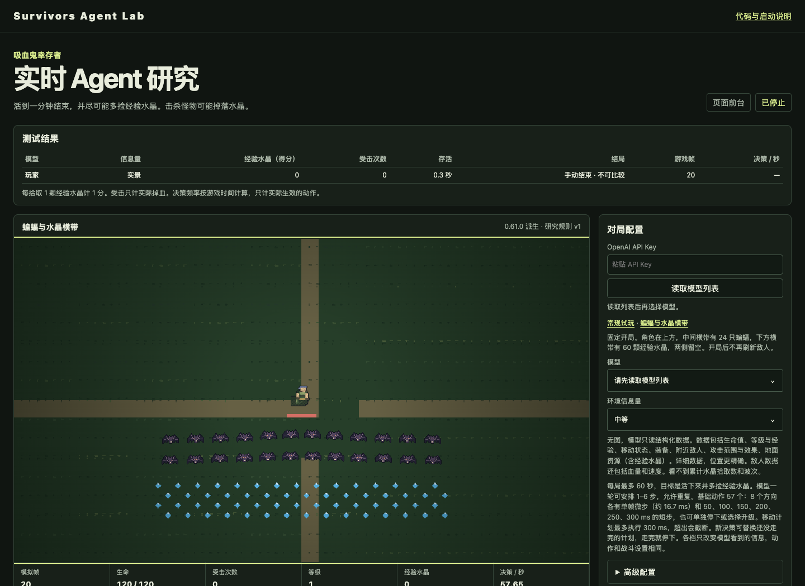
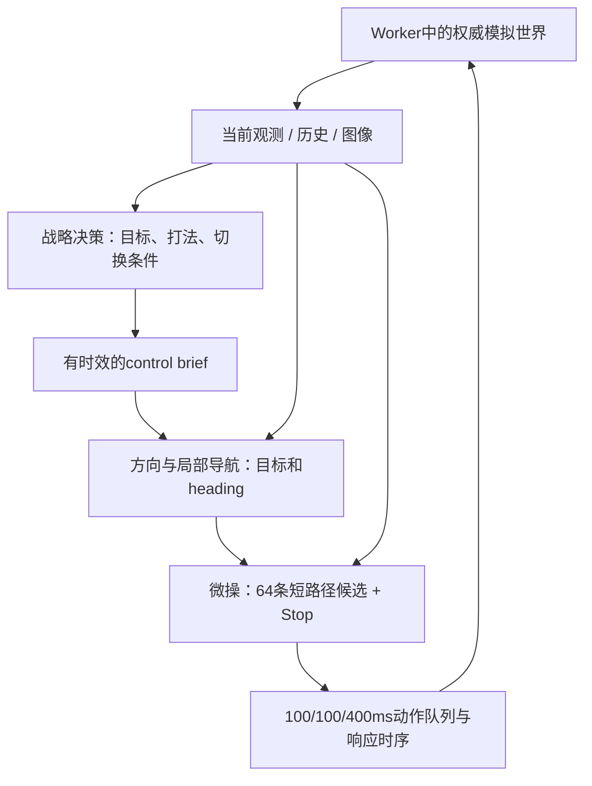

# Survivors Agent Lab

**决策 → 方向／寻路 → 微操**三层实时 Agent 实验，独立公司项目。代码来自 2026-11-17 已交付本地试玩的 **R165** 快照，不依赖 MUNDI Web 仓库、账号、数据库或本机旧实验目录。

本仓库只包含研究场景、Agent、模型协议、运行服务和测试。不包含原作贴图/音频、个人密钥、真实对局数据或 MUNDI 主站部署配置。



## 快速启动

安装 **Node.js 22.18+**（建议 Node.js 24 LTS，包含 npm），然后：

```sh
git clone https://github.com/Arkevo-Lab/mundi-survivors-agent-lab.git
cd mundi-survivors-agent-lab
npm ci
npm start
```

打开 **http://127.0.0.1:4188/?scenario=bat-crystal-bands-v1&release=R165**。

`npm start` 会自动构建浏览器页面和模拟 Worker，然后启动独立本地服务；无需先跑 MUNDI。按 `Ctrl+C` 停止。端口冲突时在 `.env` 改 `PORT`。新机器无需原作者的路径、账号或 SQLite 数据库。

**无密钥也可以打开页面、查看界面并选择真人控制。启动服务不会自动发起模型请求。** 使用三层真实模型前：

```sh
cp .env.example .env
```

在本项目 `.env` 填入自己有权限使用的 `OPENAI_API_KEY` 和 `NACE_API_KEY`，重启服务，在页面上明确启动实验。密钥只用于本地服务，不复制原实验配置，不进入 Git，也没有平台模型额度兜底。提供商计费、模型资格及网络可达性由使用者自己的账号决定。

页面读取模型列表后，选择 **GPT‑6 Luna · 决策模式**，决策方式选择 **64 路径 · 300 ms**，移动策略保持 **最新方案（局部微操）**，微操模型选 **Nace Drex Max v1.1 · 65 项**。三层策略需要两种密钥；快照沿用原 UI 的模型列表门槛，列表没有 `gpt-6-luna` 时不会显示完整三层入口。只配 OpenAI 时可使用该提供商可用的对照方案。提供商模型权限不由本项目授予。

R165 快照的模型配置：战略层 `gpt-6.1-terra` / `high`，方向与微操 `drex-max-v1.1`（Nace）。这是当时实验配置，不保证任何新账号都有这些模型的权限；配置位置见 `src/client/survivors-research/models/strategy-config.js` 和 `nace-decisions.js`。本次独立化验证不调用付费模型。

## 三层结构



- **战略层**：以当前状态和有界历史给出条件式打法；保留目标、暂时远离目标绕行、侧绕追兵、攻击侧位及回收水晶等语义。不是写死路线。
- **方向／寻路层**：解释战略和当前几何，选择目标与方向并交给微操。这里的“寻路”是模型的局部导航决策，并非暗藏 A* 或替模型躲怪的规则控制器。
- **微操层**：根据局部图、战斗状态、目标与剩余队列，从 65 个候选选择可执行短动作。保留 300ms provider 处理时钟、迟到响应和动作执行记录边界。
- **模拟层**：Worker 持有世界状态；输入合法性、升级暂停、重放、节点恢复和状态哈希仍由模拟合同约束。

## 从哪里读代码

| 目的 | 文件 |
|---|---|
| R165 三层最终提示 | `src/client/survivors-research/models/r165-prompts.js` |
| 三层共用物理／语义事实 | `src/client/survivors-research/models/r165-shared-facts.js` |
| 三层组装与默认路由 | `models/directional.js`、`models/strategy.js`、`models/local-path-micro.js` |
| 战略交接与目标连续性 | `models/control-brief.js`、`models/strategy-scheduler.js`、`models/strategy-memory.js` |
| 动作队列、时钟和执行 | `agent-loop.js`、`provider-clock.js`、`provider-execution-window.js` |
| 研究规则与模拟 | `src/shared/survivors-research-contract.js`、`sim-world.js`、`sim-run.js` |
| 蝙蝠和水晶横带场景 | `public/games/survivors-lab-research-v1/src/bat-crystal-bands.mjs` |
| 模型请求校验与提供商协议 | `src/server/survivors-research-model.js`、`survivors-research-strategy.js` |
| 独立运行服务 | `scripts/server.mjs`、`src/server/api.js` |

表内省略前缀的模型和运行文件均位于 `src/client/survivors-research/`。

## 检查

```sh
npm run check
```

这会构建页面和 Worker，并串行运行独立研究测试；不需要密钥，不消耗模型额度。测试涵盖三层提示合同、时钟与队列、短路径、公开观测、暂停、重放及恢复。上游依赖 MUNDI 账号/数据库的测试没有冒充独立项目测试，清单保存在 `docs/source-snapshot.json`。

## 来源和验证边界

- 这是从原实验 **R165 文件状态**导出的新仓库，包含原来只在本机未提交的研究改动。`docs/source-snapshot.json` 记录原始文件 SHA-256、依赖来源及独立化改动；原 Git 基线只用于追溯，不是运行依赖。
- 场景是从自有 Survivors-like 模拟派生的研究环境，程序绘制图像，**不是原作完整复刻或原生游戏控制**。旧模型/提示模块作为实验对照保留。
- 原 R165 曾通过完整宿主检查 11,144 项、0 失败、82 跳过及构建；这是历史宿主结果。本独立项目的实际验证另见 `docs/verification.md`，不能把旧计数当作新仓库测试通过数。
- 模型真实生存、战术效果和评分结果需要使用者明确启动实验观察。本次打包不自动跑模型，不导入个人对局/图片/原始提供商响应。
- 本地服务仅绑定 `127.0.0.1`，没有 MUNDI 登录、账号成绩 POST、云钱包、生产部署或自动化循环。页面的线路校准需手动触发并访问提供商公共网络接口。

公司内部研究代码，未授予第三方游戏资产再分发许可。
